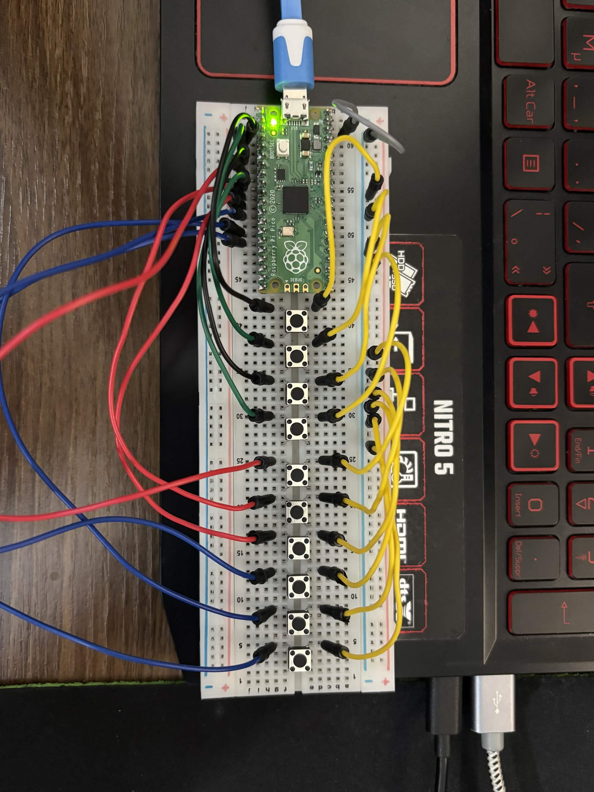

# Pico Leverless Controller

A leverless (Hitbox-style) fighting game controller built on a Raspberry Pi Pico.
It enumerates as a USB HID gamepad and was tested with Street Fighter 6 on PC.

## Features
- 4 direction inputs reported as a hat switch (D-pad)
- 6 attack buttons (LP/MP/HP/LK/MK/HK)
- SOCD cleaning: Left+Right resolves to neutral, Up+Down resolves to Up
- Reports sent only when input state changes
- Written in C with the Pico SDK and TinyUSB

## Hardware
- Raspberry Pi Pico (RP2040)
- Tactile switches/buttons (prototype stage), each wired between a GPIO pin and GND
- Breadboard, jumper wires, USB cable

## Pin mapping
| Input | GPIO |
|---|---|
| Left | GP2 |
| Down | GP3 |
| Right | GP4 |
| Light Punch | GP5 |
| Up | GP6 |
| Medium Punch | GP7 |
| Heavy Punch | GP8 |
| Light Kick | GP9 |
| Medium Kick | GP10 |
| Heavy Kick | GP11 |

Buttons use the Pico's internal pull-ups, so they read low when pressed.

## How it works
The firmware runs a single loop. Each pass it services the TinyUSB device stack, then
reads all ten button pins (active low, using the Pico's internal pull-ups). It applies SOCD cleaning to the four directions, builds a HID gamepad report with the directions as a hat switch and the six attacks as buttons, and sends the report only when the state differs from the last one sent. The onboard LED blinks slowly once the PC has enumerated the device.

## Building
1. Install VS Code and the Raspberry Pi Pico extension
2. Open this folder, select board `pico`, and click Compile
3. Hold BOOTSEL, plug in the Pico, and drag `build/hid_gamepad.uf2` onto the RPI-RP2 drive

## Using it with Street Fighter 6
The Pico is read as a generic USB gamepad to the PC, so it needs a one-time mapping in Steam:
1. Open Steam's controller settings
2. Run `Begin Setup` for the device
3. Assign the directions and six attack buttons to the Xbox-style layout (X, Y, RB for punches; A, B, RT for kicks)

## Problems I ran into
- Buttons placed on one half of the breadboard are shorted and permanently read as pressed. Placing each switch across the center gap ensures that it is only read as active when pressed, and neutral when unpressed. This is verified by observing the state of the point of view hat in Windows' `Set up USB game controllers` test window
- Windows detected the controller, but it was unresponsive in game until the device controls were mapped in Steam controller settings
- A tactile switch was faulty (dead on arrival), which looked like a wiring or firmware problem until it was swapped

## Future work
- XInput emulation
- Custom PCB and enclosure with arcade buttons

## Credits
Based on the TinyUSB HID composite example (MIT license).